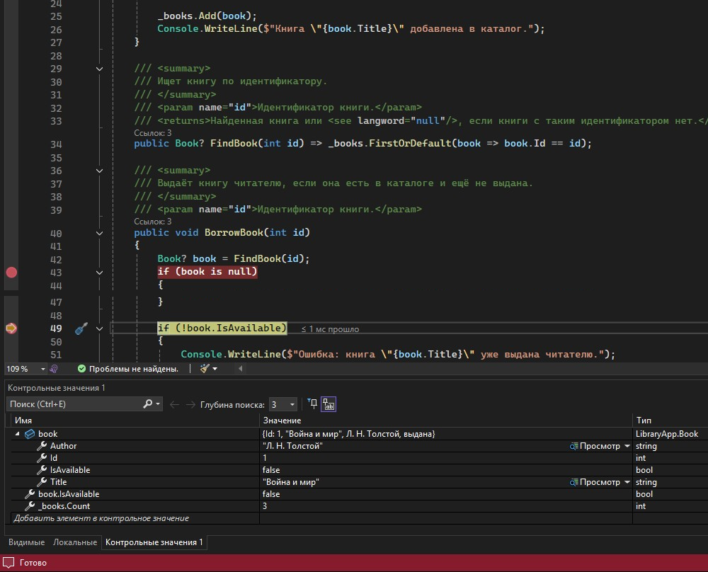
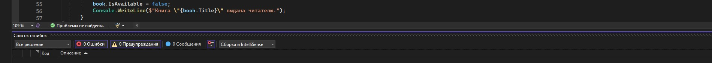

# LibraryApp

Учебное консольное приложение на C# (.NET 8) для учёта книг в библиотеке. Проект создан
в рамках практической подготовки по дисциплине ИСРПО и демонстрирует полный цикл контроля
качества программного модуля: реализацию предметной области, отладку, инспекцию кода
и документирование результатов.

## Возможности

- каталог книг в памяти с поиском по идентификатору;
- выдача книги с проверкой существования и доступности;
- возврат книги с проверкой, что она действительно была выдана;
- защита от `null` и дубликатов идентификаторов при добавлении;
- наглядная демонстрация шести сценариев работы в `Program.cs`.

## Структура проекта

```
LibraryApp/
├── LibraryApp.sln
├── LibraryApp/
│   ├── Book.cs          # модель книги
│   ├── Library.cs       # каталог и бизнес-логика
│   ├── Program.cs       # точка входа, демонстрационные сценарии
│   └── LibraryApp.csproj
├── docs/screenshots/    # скриншоты отладки и результатов анализа
├── .editorconfig        # правила стиля и анализа кода
├── .gitignore
├── README.md
└── TEST_REPORT.md       # отчёт о тестировании и инспекции кода
```

## Требования

- .NET SDK 8.0 или новее (проект собирался SDK 9.0.311, целевая платформа `net8.0`);
- Visual Studio 2022 (17.8+) — для отладки и работы с анализаторами (необязательно).

## Запуск

Из командной строки в корневой папке решения:

```bash
dotnet run --project LibraryApp/LibraryApp.csproj
```

Ожидаемый результат: каталог из трёх книг и последовательный вывод шести сценариев —
успешная выдача, отказ при повторной выдаче, отказ при возврате невыданной книги,
сообщение об отсутствующей книге, успешный возврат и повторный отказ. Процесс завершается
с кодом 0.

В Visual Studio: откройте `LibraryApp.sln`, нажмите F5.

## Отладка

Точки останова в Visual Studio удобно ставить в методах `Library.BorrowBook`,
`Library.ReturnBook` и `Library.FindBook`. В окнах «Локальные» и «Контрольные значения»
контролируются `book`, `book.IsAvailable` и `_books.Count`.

## Сборка и анализ кода

```bash
dotnet build LibraryApp/LibraryApp.csproj
```

В проекте включены nullable-анализ, XML-документация, анализаторы (`AnalysisLevel`,
`AnalysisMode=All`) и проверка стиля при сборке. Текущее состояние: **0 ошибок,
0 предупреждений**.

## Результаты работы

- найдено и исправлено 5 дефектов (включая `NullReferenceException` при обращении
  к несуществующей книге);
- все сценарии проверены в отладчике Visual Studio (Locals, Watch, стек вызовов);
- код приведён к единому стилю, публичный API документирован;
- подробности — в [TEST_REPORT.md](TEST_REPORT.md).




